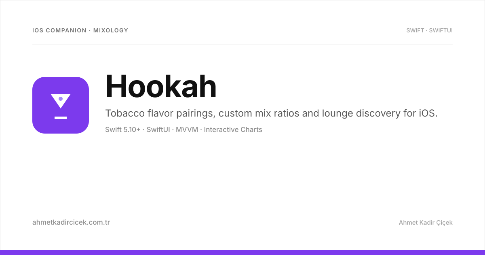
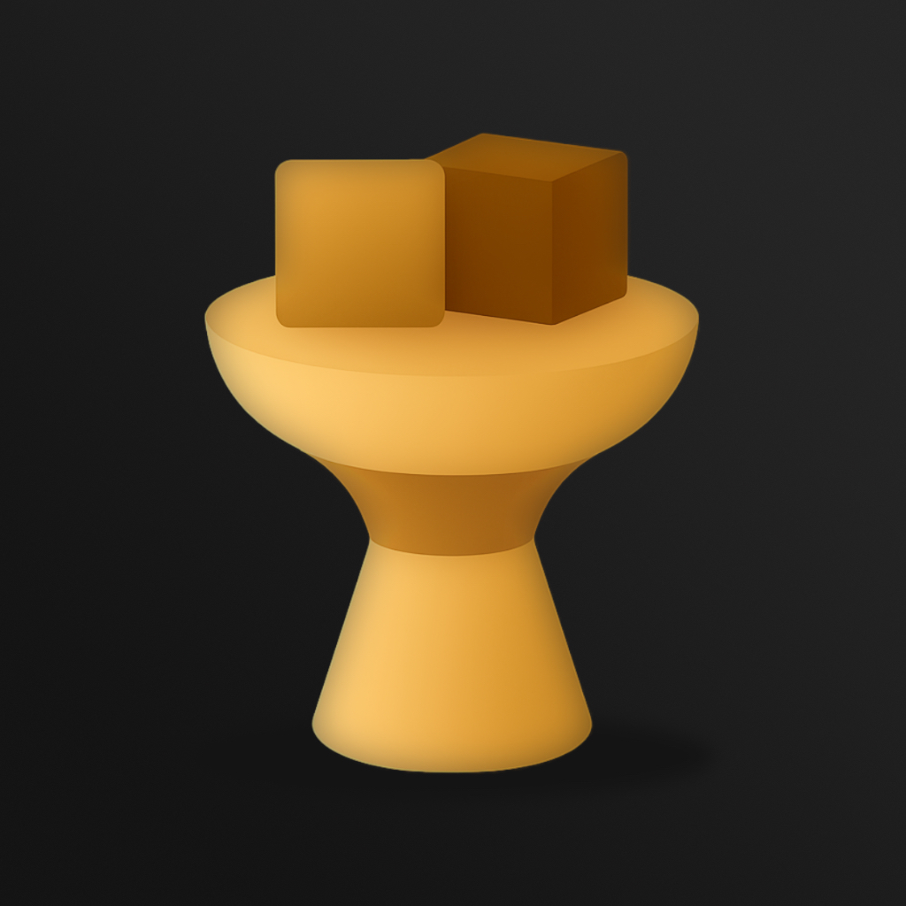

# Hookah — iOS Mixology & Lounge Companion

<div align="center">



### Artisanal flavor mixology, intensity metrics, tobacco profiling and lounge discovery built with Swift & SwiftUI.

[](https://swift.org)
[](https://developer.apple.com/ios/)
[](https://developer.apple.com/xcode/swiftui/)
[](https://developer.apple.com/documentation/)
[](LICENSE)

<br/>

<p align="center">
  
</p>

</div>

---

## 🍃 Overview

**Hookah** is a specialized iOS lifestyle and mixology application designed for hookah enthusiasts and premium lounge patrons. It cataloges artisanal tobacco blends, provides exact multi-component flavor ratio breakdowns with interactive pie charts, visualizes nicotine strength and flavor intensity indicators, and maps local cafes and hookah lounges with verified menus.

---

## ✨ Features

- **Artisanal Mix Breakdown**: Detailed ratio recipes (e.g., 60% Blonde Leaf Citrus + 40% Dark Leaf Mint) visualized with custom `PieChart` components.
- **Flavor & Tobacco Profiling**: Search and filter by tobacco leaf cut (Blonde Leaf, Dark Leaf, Cigar Blend), intensity scale (`●●●●○`), and flavor notes (fruity, icy, spiced, floral).
- **Lounge & Cafe Directory**: Detailed cafe profiles (`CafeModel`) with ambiance tags, address location, and curated house specials.
- **Interactive Mix Filter Panel**: Multi-criteria toolbar allowing filtering by category tags, price tiers, and user ratings.
- **Warm Modern Dark Design**: Premium color tokens (`caviar`, `sundial`, `chicoryBrown`, `goldenOlive`, `rawSienna`) optimized for OLED displays.
- **Decoupled Architecture**: Clean state isolation through `AppState`, feature-driven module hierarchies, and lightweight native dependencies.

---

## 🏛️ Project Structure

```
Hookah/
├── Application/          # HookahApp entry point, AppState, AppDelegate
├── Features/             # Domain modules
│   ├── Home/             # Featured slider, hero cards, search bar & recommendations
│   ├── Mixes/            # Comprehensive mix list, filter drawer & ViewModel
│   ├── MixDetails/       # Mix ratio card, flavor note list, intensity scale & pie chart
│   ├── Flavors/          # Individual tobacco brand & single-flavor encyclopedia
│   └── Splash/           # Atmospheric brand splash view & animated logo
├── Shared/               # Reusable domain models, extensions & components
│   ├── Models/           # MixModel, FlavorModel, CafeModel
│   ├── Components/       # PieChart, FilterTag, TobaccoTypeTag, IntensityIndicator
│   └── Extensions/       # String, Font, and CGFloat extensions
└── Resources/            # Assets.xcassets (Color sets, Image assets, AppIcon)
```

---

## 🛠️ Build & Run Locally

### Requirements
- **macOS Sonoma** or later
- **Xcode 15+** with iOS 17 SDK

```bash
# 1. Clone repository
git clone https://github.com/ahmetkadircicek/hookah.git
cd hookah

# 2. Check out the development branch
git checkout dev

# 3. Open project in Xcode
open Hookah.xcodeproj
```

Select an iOS Simulator or connected iPhone and press `⌘R`.

---

## 👨‍💻 Author

**Ahmet Kadir Çiçek**
- Website: [ahmetkadircicek.com.tr](https://ahmetkadircicek.com.tr)
- GitHub: [@ahmetkadircicek](https://github.com/ahmetkadircicek)
- LinkedIn: [in/akadircicek](https://www.linkedin.com/in/akadircicek)

---

## 📄 License

This repository is licensed under the [MIT License](LICENSE).
